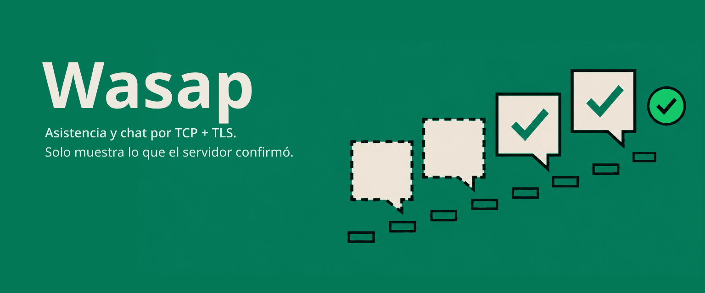
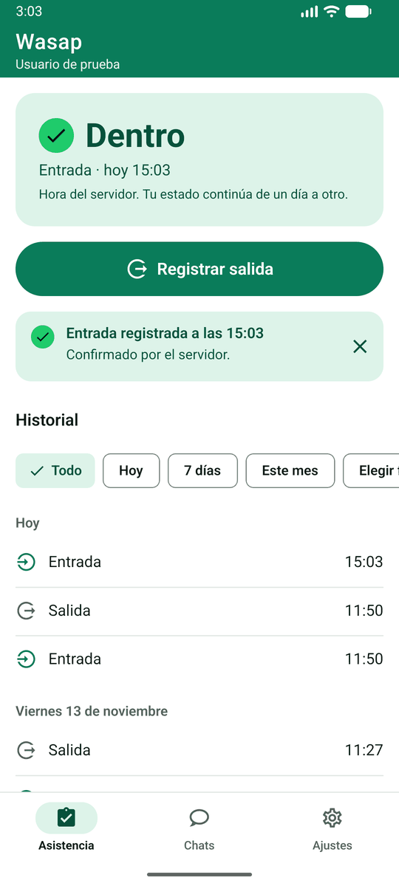
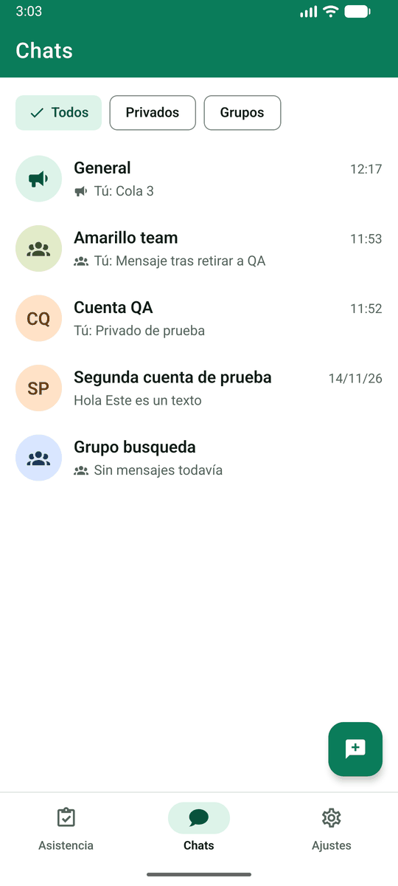
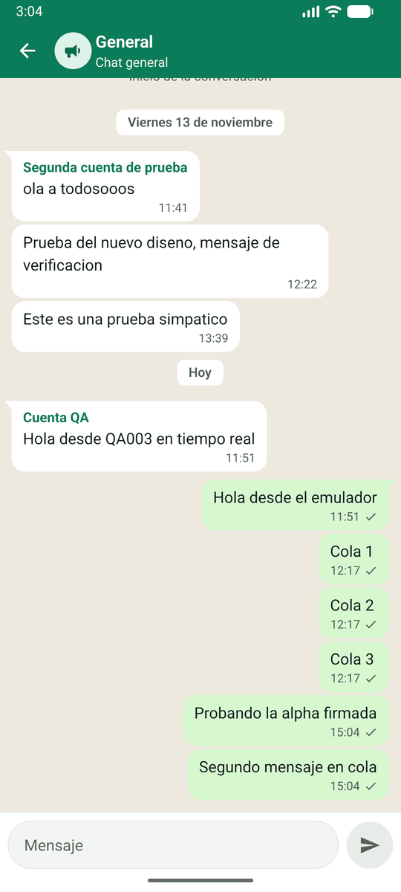
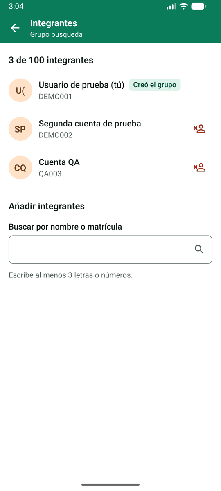
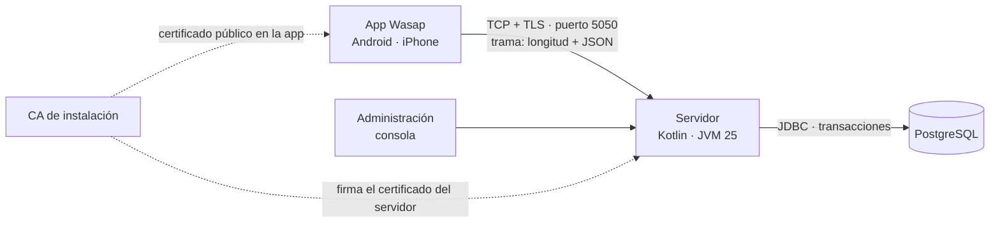
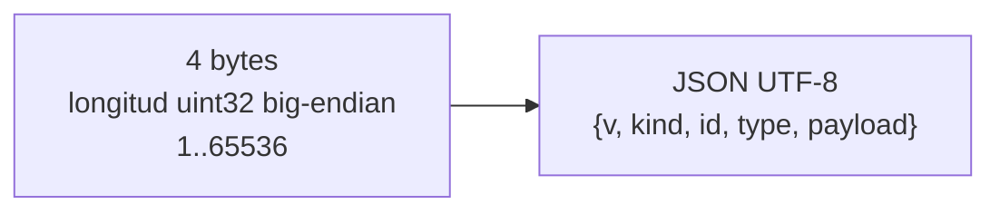

<p align="center">
  
</p>

# Wasap 2 — asistencia y mensajería TCP

Wasap pasa lista y deja chatear al grupo desde Android o iPhone dentro de la red
local. Es una sátira cariñosa del mensajero verde con una regla seria: **la app solo
muestra lo que el servidor confirmó**. Un reloj es «pendiente», una palomita es
«guardado por el servidor» y reintentar nunca duplica un registro.

- **Asistencia** alternada entrada/salida, sin reinicio diario, con historial propio.
- **Chat** general, privados y grupos (hasta 100 integrantes), con cola de envío en orden.
- **Protocolo propio** sobre TCP + TLS, sin HTTP, con idempotencia por UUID.
- **Servidor** Kotlin/JVM 25 con PostgreSQL; solo el servidor conoce sus credenciales.

## En pantalla

Capturas reales de la alpha firmada en Android ([más en la verificación](docs/verification.md)).

| Asistencia                                                                                                               | Chats                                                                                                | Conversación                                                                                                           | Integrantes                                                                                                  |
| ------------------------------------------------------------------------------------------------------------------------ | ---------------------------------------------------------------------------------------------------- | ---------------------------------------------------------------------------------------------------------------------- | ------------------------------------------------------------------------------------------------------------ |
|  |  |  |  |

## Cómo encaja



Cada mensaje del protocolo es una trama: 4 bytes con la longitud y, a continuación,
un objeto JSON en UTF-8 ([contrato completo](docs/protocol.md)).



## Documentación y evidencia

- [Arquitectura y recorridos](docs/architecture.md): diagramas de componentes, red local, confirmación y estados.
- [Capturas y verificación](docs/verification.md): imágenes reales de Android, resultados y pendientes.
- [Protocolo TCP/TLS](docs/protocol.md): tramas, operaciones, permisos y recuperación.
- [Entorno local con Compose](docs/local-runtime.md): PostgreSQL persistente y servidor.
- [Guía móvil](mobile/README.md): emulador por CLI, Android, Xcode y EAS.
- [Necesidades de backend](docs/mobile-backend-needs.md): cambios completados y opciones futuras.

## Base y servidor locales con Compose

Para desarrollo, [la guía local](docs/local-runtime.md#postgresql-y-servidor-con-compose-recomendado) levanta PostgreSQL persistente y el servidor juntos con `compose.local.yaml`. En Podman utiliza también `compose.local.podman.yaml`. El archivo `compose.yaml` de la siguiente sección requiere una base externa.

## Servidor con Docker

Necesitas Docker con Compose, OpenSSL y una base PostgreSQL (17 o posterior) ya
creada. La cuenta de la base debe poder crear el esquema y ejecutar las migraciones.

```bash
cp .env.example .env
bash scripts/create-certs.sh 192.168.1.50
```

Sustituye la IP por la del equipo servidor. Edita `.env` con la URL JDBC, usuario y
tu UID/GID (`id -u` y `id -g`); esto permite leer archivos privados sin ejecutar el
servidor como root. `PROCESSED_REQUEST_RETENTION_DAYS` (30 por defecto, mínimo 1)
fija cuántos días se guardan los registros que evitan duplicar operaciones
reintentadas; el servidor los purga cada hora y no arranca si el valor no es válido. El puerto predeterminado es 5050 y debe estar permitido en el
firewall de la LAN. Los teléfonos necesitan alcanzar la IP del equipo anfitrión,
no la IP interna del contenedor. La red Wi-Fi no debe aislar sus clientes.

Guarda la contraseña de PostgreSQL en un archivo local protegido:

```bash
umask 077
read -rs -p 'Contraseña PostgreSQL: ' wasap_db_password
printf '%s' "$wasap_db_password" > certs/db-password
unset wasap_db_password
docker compose up --build -d
docker compose logs -f server
```

La URL de ejemplo usa las CA públicas del JDK y valida la identidad de PostgreSQL.
Si tu proveedor entrega una CA privada, monta su certificado en el contenedor y
configura `sslrootcert` según pgJDBC. No desactives la validación TLS para producción.
El contenedor aplica las migraciones antes de escuchar y comprueba su salud por
TLS y base de datos. Las contraseñas y certificados privados no van en la imagen.

El certificado público `certs/ca.crt` se incorpora a la compilación móvil. Si cambia
la CA sí se necesita recompilar la app; cambiar de IP o renovar el certificado del
servidor, no.

### Certificados desde el servidor (recomendado)

El servidor guarda la clave de la CA **cifrada con una frase tuya** en `certs/tls/`
(montado como `TLS_DIR`) y emite y recarga su propio certificado sin reiniciar.
Créalo una vez y pásale tu CA actual:

```bash
mkdir -p certs/tls && chmod 700 certs/tls
docker compose run --rm -T -v ./certs/ca.key:/run/wasap/ca.key:ro server \
  certs import /run/wasap/ca.key /run/wasap/ca.crt
```

El comando pide una frase de al menos 12 caracteres (en una terminal no se muestra).
Después, **borra `certs/ca.key` de este equipo** y guarda una copia offline junto con
la frase: sin la frase la clave cifrada no sirve, y sin la copia no podrás recuperar
la CA. En una instalación nueva, `certs init` crea la CA directamente.

Para emitir o renovar el certificado del servidor:

```bash
docker compose exec server /app/bin/wasap-server certs issue            # direcciones detectadas
docker compose exec server /app/bin/wasap-server certs issue \
  --address 192.168.1.50 --address 10.8.0.1 --dns wasap.escuela.local  # o explícitas
docker compose exec server /app/bin/wasap-server certs status
```

El certificado cubre todas las direcciones indicadas (más `127.0.0.1`), así sirve a
teléfonos de varias redes. Dentro del contenedor solo se ven sus propias interfaces:
pon las IPs del equipo anfitrión en `SERVER_PUBLIC_ADDRESSES` o pásalas con
`--address`. El servidor en marcha usa el certificado nuevo en las conexiones nuevas
en unos 10 segundos; las abiertas siguen igual. Mientras no emitas ninguno, sigue
usando `certs/server.p12`. Los certificados duran un año. Cuando falten menos de 30
días, el servidor escribe `WARNING: TLS certificate expires on …` al arrancar y una vez
al día (`docker compose logs server`). Un certificado vencido impide arrancar.

Para que los teléfonos añadan este servidor, muestra su código QR:

```sh
docker compose exec server /app/bin/wasap-server certs qr
docker compose exec server /app/bin/wasap-server certs qr --address 192.168.1.50 --png /var/lib/wasap/tls/qr.png
```

El QR lleva el identificador y el nombre del servidor, sus direcciones y el certificado
público de la CA (nunca claves). Es denso: escanéalo desde la pantalla o imprímelo a
8 cm o más. La consola también imprime el enlace `wasap://server?…` para compartirlo
como texto. Ver [añadir servidores con su código QR](mobile/README.md#añadir-servidores-con-su-código-qr).

`scripts/create-certs.sh` sigue disponible para crear la CA inicial sin el servidor.
No incluyas `certs/` ni `.env` en Git.

Para probar desde Linux sin abrir Android Studio, sigue la [guía para iniciar el emulador por terminal](mobile/README.md#emulador-android-desde-la-terminal-sin-abrir-android-studio), con conexión al servidor local y Metro.

## Administración

```bash
docker compose exec server /app/bin/wasap-server admin users add 20260001 'Ana Pérez'
docker compose exec server /app/bin/wasap-server admin users list
docker compose exec server /app/bin/wasap-server admin users reset-pin 20260001
docker compose exec server /app/bin/wasap-server admin users logout 20260001
docker compose exec server /app/bin/wasap-server admin users role 20260100 teacher
docker compose exec server /app/bin/wasap-server admin server name 'Redes 5.º A'
docker compose exec server /app/bin/wasap-server admin attendance 20260001 2026-11-01 2026-11-30
docker compose exec server /app/bin/wasap-server admin attendance '*' 2026-11-01 2026-11-30
docker compose exec -T server /app/bin/wasap-server admin attendance '*' 2026-11-01 2026-11-30 --class CLASE_ID --csv > redes.csv
```

El PIN se solicita sin mostrarlo en una terminal interactiva; no lo pases como
argumento. Restablecerlo invalida las sesiones anteriores: un teléfono que ya estaba
conectado deja de recibir datos en un máximo de 5 segundos y se le pide iniciar sesión.
`admin users logout` cierra todas las sesiones de una persona sin cambiar su PIN (por
ejemplo, si perdió el teléfono) e indica cuántas cerró; los teléfonos conectados dejan
de recibir datos en un máximo de 5 segundos. La consulta de asistencia
devuelve hasta 100 movimientos y un `nextCursor`; pásalo como último argumento para
continuar. Las fechas son inclusivas en `APP_TIMEZONE` (America/Mexico_City por defecto).

### Altas sin conocer el PIN

El PIN siempre lo elige el estudiante. Hay dos formas de darlo de alta:

```sh
# Invitaciones personales (una o desde un CSV «matricula,nombre»), opcionalmente a una clase:
docker compose exec server /app/bin/wasap-server admin invites add 20260001 'Ana Pérez' --class CLASE_ID
docker compose exec server /app/bin/wasap-server admin invites import /var/lib/wasap/tls/grupo.csv --class CLASE_ID --png /var/lib/wasap/tls/qr
# Autorregistro: el profesor ve el código de su clase en «Lista de la clase»; se aprueba ahí o aquí:
docker compose exec server /app/bin/wasap-server admin signups
docker compose exec server /app/bin/wasap-server admin signups approve 20260002
```

- **Invitación:** un código de un solo uso que caduca en 7 días (`--days` de 1 a 30).
  La consola imprime `matricula,nombre,caduca,enlace` y, con `--png`, un QR por
  estudiante. Al escanearlo, la app añade el servidor y solo pide elegir el PIN. Un
  profesor invita desde el protocolo a sus clases; nunca a una matrícula que ya tiene
  cuenta (esa se añade a la clase). La invitación de un administrador para una cuenta
  existente sirve para restablecer su PIN.
- **Autorregistro:** cada clase tiene un código de 8 caracteres renovable. En la app,
  «Soy nuevo: tengo un código de clase» pide matrícula, nombre y PIN; la cuenta queda
  pendiente (`PENDING_APPROVAL` al entrar) hasta que el profesor la aprueba. Máximo 20
  solicitudes pendientes por clase.

Cada cuenta es `student` al crearse. `admin users role` la cambia a `teacher` (puede
crear clases con asistencia propia desde la app y ver su lista) o a `admin` (además
asigna roles desde la app y ve la lista de cualquier clase); el cambio llega a los
teléfonos conectados en un máximo de 5 segundos. Con `--class` la consulta se limita
a una clase y con `--csv` exporta todas las páginas con columnas matrícula, nombre,
clase («General» para la puerta), tipo e instante local.

## App Android e iPhone

Consulta [la guía móvil](mobile/README.md). El mismo proyecto permite compilaciones
en EAS y compilaciones locales en macOS con Xcode. Android puede compilarse localmente
con su SDK. Se utiliza una compilación nativa propia; Expo Go no incorpora el módulo TCP.

Añade el servidor escaneando su código QR (o configura a mano el servidor de
instalación), inicia sesión con matrícula/PIN y registra tu asistencia. La app guarda
hasta 10 servidores, cada uno con su sesión. Cada usuario consulta solo su historial. El creador de un grupo administra
sus integrantes; al retirar a alguien pierde acceso a futuras consultas y entregas.
Los grupos admiten hasta 100 miembros. Los mensajes son de texto, hasta 4000 caracteres.

La app recupera historial al volver del segundo plano y tras reconectar. No crea
nuevas operaciones sin conexión. Puedes escribir varios mensajes seguidos: quedan
guardados en el teléfono (hasta 20) y se envían en orden; si el servidor rechaza uno
de forma definitiva, se marca como no enviado y puedes copiarlo o descartarlo.
Conserva las operaciones ya enviadas que aún no tengan confirmación y las reconcilia
con el mismo identificador. Cambiar de servidor
conserva lo pendiente de cada uno; cerrar sesión no traslada pendientes a otra identidad. Las sesiones caducan a las
24 horas y sobreviven a los reinicios del servidor. No hay notificaciones push ni panel web en v1.

## Desarrollo y pruebas

Necesitas JDK 25 completo. El wrapper descarga la versión fijada de Gradle.

```bash
cd server
./gradlew test installDist
```

Las pruebas de integración usan PostgreSQL real y crean/eliminan exclusivamente
esquemas temporales con nombre aleatorio. Para ejecutarlas desde la raíz:

```bash
docker compose -f compose.test.yaml up -d --wait
export WASAP_TEST_DB_URL='jdbc:postgresql://127.0.0.1:55432/wasap_test?sslmode=disable'
export WASAP_TEST_DB_USER=wasap_test
export WASAP_TEST_DB_PASSWORD=wasap_test
cd server
./gradlew test integrationTest
cd ..
docker compose -f compose.test.yaml down
```

El PostgreSQL de pruebas es efímero y solo se publica en localhost. No uses una base
de producción para pruebas. OpenSSL es necesario para la prueba de sockets TLS.
`DB_ALLOW_INSECURE=true` existe exclusivamente para desarrollo/pruebas locales.

El [contrato del protocolo](docs/protocol.md) define tramas, operaciones, cursores,
errores y garantías de reintento. Los mensajes y asistencias se confirman después
del commit; si PostgreSQL falla no se muestra una confirmación falsa.
