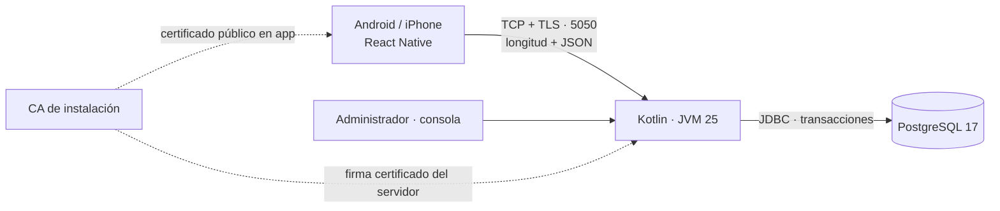
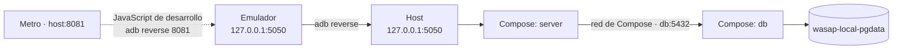
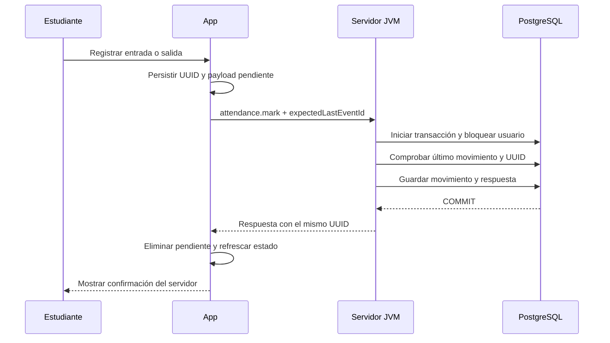
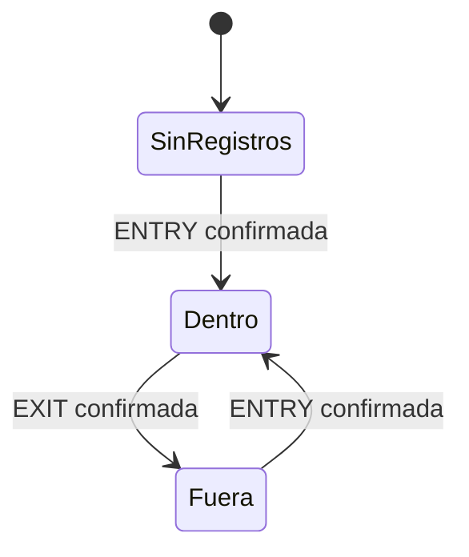

# Arquitectura y recorridos de Wasap

Wasap es un proyecto académico de redes: registra entrada/salida y ofrece
mensajería general, privada y de grupo. El servidor JVM decide la identidad,
el orden de los registros y cuándo una operación queda confirmada.

## Componentes



La app guarda el token en SecureStore y una operación sin confirmar en
AsyncStorage. El servidor guarda registros y respuestas de mutaciones en
PostgreSQL, dentro de una misma transacción. Las sesiones también se guardan en
PostgreSQL (solo el hash SHA-256 del token): caducan a las 24 horas y sobreviven
a los reinicios del servidor. Restablecer el PIN o `admin users logout` las borra.

## Entorno local con emulador



La base no publica su puerto al host. El volumen persiste cuando se baja
Compose. Metro sirve el código de desarrollo; los mensajes y asistencias viajan
por la conexión TCP/TLS propia. Consulta [la guía local](local-runtime.md) para
los comandos y [la guía móvil](../mobile/README.md) para iniciar el AVD por CLI.

## Registro de asistencia y confirmación



Si se pierde la respuesta después del commit, la app reenvía el mismo UUID y
contenido: el servidor devuelve el resultado guardado. Si el último movimiento
cambió desde que se leyó, responde CONFLICT y el cliente recupera el estado
vigente. TCP garantiza el transporte ordenado de bytes; esta lógica de
aplicación relaciona la confirmación con el commit y evita duplicar el efecto.

## Cola de salida de mensajes

```mermaid
sequenceDiagram
    participant U as Estudiante
    participant A as App
    participant Q as Cola en el teléfono
    participant S as Servidor JVM
    U->>A: Escribe varios mensajes
    A->>Q: Guarda cada uno con su UUID (máx. 20)
    A-->>U: Burbujas «Pendiente», compositor libre
    loop Uno a uno, en el orden escrito
        A->>S: messages.send (UUID del primero)
        alt Confirmado
            S-->>A: Mensaje con seq
            A->>Q: Quita el primero
        else UNAVAILABLE, sin respuesta o sesión vencida
            S-->>A: Error reintentable
            A->>A: Detiene la cola intacta; reintenta al reconectar
        else Error definitivo
            S-->>A: FORBIDDEN, INTERNAL, VALIDATION…
            A->>Q: Quita solo ese mensaje
            A-->>U: «No enviado»: copiar al cuadro o descartar
        end
    end
```

Enviar de uno en uno mantiene el orden: el servidor asigna la secuencia al
confirmar cada mensaje. Asistencia, privados y grupos no se encolan: solo empiezan
con la cola vacía.

## Estado que continúa entre días



No hay reinicio a medianoche. El servidor aporta `timezone` y `today` para
los filtros relativos; los instantes se guardan en UTC. La interfaz distingue
una operación pendiente de una confirmada y no permite otra mientras el
resultado anterior siga sin resolverse.

## Conversaciones y permisos

| Tipo | Acceso | Administración |
| --- | --- | --- |
| GENERAL | Usuarios autenticados | Conversación común |
| DIRECT | Sus dos integrantes | Integrantes inmutables; `peer` identifica a la otra persona |
| GROUP | Integrantes actuales | El creador añade y retira miembros; no puede retirarse |

Retirar a un integrante deniega nuevas consultas y entregas. El servidor vuelve
a comprobar los permisos justo antes de escribir una trama protegida, con una
consulta breve que termina antes de escribir: ningún cliente lento retiene
conexiones ni locks de la base. El texto ya descargado no se puede retirar del
teléfono. El aviso `conversations.changed` llega solo a los integrantes afectados.

## Seguridad y límites

- TLS valida CA, vigencia y SAN de la IP o nombre configurado.
- La app incorpora la CA pública; las claves y contraseñas permanecen fuera de Git.
- PIN de 6–12 dígitos, almacenado como hash PBKDF2 con sal.
- Tramas de hasta 65536 bytes y páginas acotadas por presupuesto de bytes.
- Grupos de hasta 100 integrantes; texto de hasta 4000 unidades UTF-16.
- No se muestran lectura, presencia ni contadores sin datos del servidor.
- Matrícula/PIN y acceso a la LAN no prueban por sí solos presencia física en el aula.

El contrato detallado está en [protocol.md](protocol.md). Las capturas y el
alcance de las pruebas están en [verification.md](verification.md).
