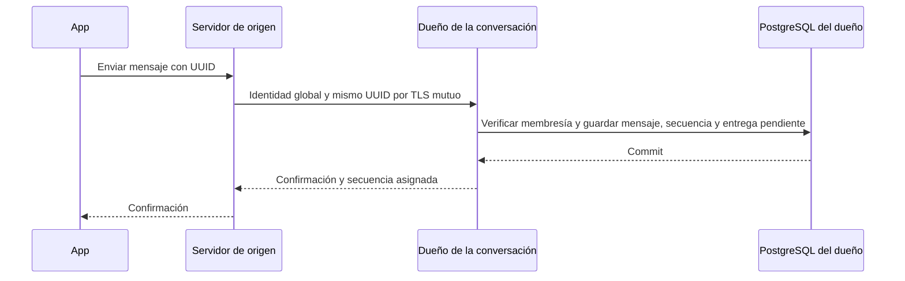
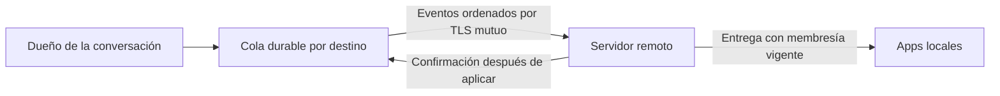

# Diseño de federación

Este borrador describe cómo compartir conversaciones entre instalaciones Wasap.
La v2 admite varias instalaciones independientes en la app. La federación requeriría
un protocolo entre servidores y almacenamiento persistente para las réplicas.

## Identidad y autoridad

La identidad global es `matricula@serverId`. El servidor de origen verifica el
PIN, emite las sesiones locales y responde por la identidad ante sus pares. Un
servidor remoto recibe la identidad, el nombre y el ID de la operación. El PIN y el
token de sesión permanecen entre el cliente y su servidor de origen.

Cada conversación tiene un servidor dueño. El dueño autoriza la membresía y las
mutaciones, asigna una secuencia estrictamente creciente por conversación y
confirma después del commit. El servidor de origen reenvía las solicitudes al
dueño con un UUID estable y transmite al cliente la confirmación del dueño. Los
registros de asistencia permanecen en la instalación que los recibe.

## Confianza, entrega y fallos

Los operadores registran cada par mediante un intercambio explícito de ID y CA
pública. TLS mutuo valida los dos certificados contra los pares autorizados.
El handshake liga el ID anunciado a ese registro. `server.hello` anuncia las
versiones compatibles. Las operaciones federadas se negocian en `v:2` y las
conexiones móviles conservan el protocolo actual.

El dueño mantiene una cola durable por destino. El mensaje y sus entregas
pendientes se guardan juntos. Cada destino confirma después de aplicar el evento
a su réplica, deduplica por UUID dentro de la conversación y pide recuperar
eventos si detecta un hueco. Los reintentos tras perder una confirmación usan el
mismo UUID y recuperan el resultado original.

Los cambios de membresía viajan antes que los mensajes posteriores de la misma
conversación. El destino aplica cada revocación antes de reanudar entregas y
descarta los eventos que el usuario retirado ya no puede recibir. El dueño
excluye de la cola nueva a los destinos sin miembros vigentes. Si el dueño está
caído, los orígenes conservan las operaciones como pendientes. Si un destino está
caído, el dueño continúa confirmando sus propios commits y conserva la cola de
ese destino. Tras una expulsión de un par, volver a confiar en él exige una nueva
autorización explícita.

## Requisitos propuestos

### Identidad y confianza

Cada servidor SHALL aceptar operaciones federadas únicamente de pares
autorizados por TLS mutuo y SHALL atribuir una identidad a su servidor de origen.

- **WHEN** un par presenta un certificado válido para su servidor pero reclama la
  identidad de un usuario de otro origen
- **THEN** el receptor rechaza la operación antes de aplicar una mutación

### Orden y confirmación

El dueño SHALL confirmar cada operación una vez guardada y SHALL devolver el mismo
resultado al recibir otra vez el UUID para la misma identidad y operación.

- **WHEN** se pierde la respuesta después del commit y el origen reenvía la solicitud
- **THEN** el dueño devuelve la secuencia original y la conversación conserva una
  sola copia del mensaje

### Revocación y recuperación

El destino SHALL aplicar cambios de membresía en orden antes de entregar mensajes
posteriores y SHALL reanudar la réplica desde su último evento aplicado.

- **WHEN** un destino pierde conexión, el dueño retira a un integrante y se envía
  otro mensaje antes de la reconexión
- **THEN** el destino aplica la retirada al recuperar la secuencia y el integrante
  retirado queda excluido de la entrega posterior
