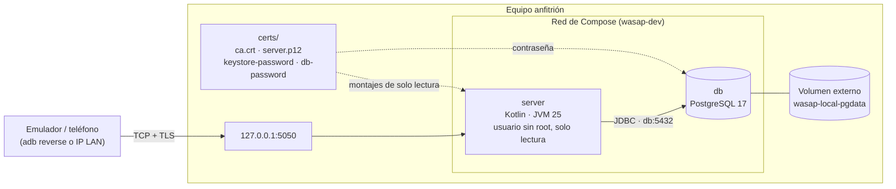

# Entorno local de prueba

Se ha iniciado con Podman (motor instalado, compatible con imágenes Docker).

- `wasap-local-db`: PostgreSQL 17, base/usuario `wasap`, red privada `wasap-local`.
- `wasap-local-server`: JVM/TLS publicado únicamente en `127.0.0.1:5050`.
- Datos persistentes: volumen `wasap-local-pgdata`. No eliminarlo para conservar asistencias.
- Configuración privada generada en `.local/`, ignorada por Git; contraseña en `certs/db-password`.
- PostgreSQL usa conexión sin TLS únicamente en esta red local privada de contenedores.
  La conexión app-servidor sigue usando TLS con la CA de `certs/ca.crt`.

## Emulador

```bash
/home/kedap/Android/Sdk/platform-tools/adb reverse tcp:5050 tcp:5050
```

Configurar en Wasap `127.0.0.1`, puerto `5050`. Matrícula inicial `DEMO001`,
PIN de demostración `123456`. Cambiarlo antes de usar datos reales.

## Operación

```bash
podman logs --tail 50 wasap-local-server
podman exec wasap-local-server /app/bin/wasap-server healthcheck
podman stop wasap-local-server wasap-local-db
podman start wasap-local-db wasap-local-server
podman exec -it wasap-local-server /app/bin/wasap-server admin users add DEMO002 'Otra persona'
podman exec wasap-local-server /app/bin/wasap-server admin attendance DEMO001
```

La imagen usada es `localhost/wasap-server:dev`. Para modificar el código del
servidor hace falta reconstruirla y recrear su contenedor conservando los montajes,
la red, variables de `.local/server.env` y el volumen PostgreSQL. La configuración
Compose de producción permanece independiente y exige PostgreSQL remoto con TLS.

## Despliegue local



La base no publica puertos al anfitrión. El servidor aplica las migraciones
(Flyway) antes de escuchar. Compose local publica la app en `127.0.0.1:5050` y el
panel en `127.0.0.1:5443`; para dispositivos en la LAN, `compose.yaml` publica los
puertos en las interfaces del anfitrión.

## PostgreSQL y servidor con Compose (recomendado)

Desde la raíz del repositorio, el archivo local incluye ambos servicios. No
requiere `DB_URL` en el entorno. `compose.yaml`, sin sufijo, corresponde a una
base externa y por eso falla con «required variable DB_URL» si no la configuraste.

En este equipo ya existen los certificados, el archivo privado
`certs/db-password` y el volumen con los datos. No regeneres esa contraseña:
PostgreSQL conserva la original cuando reutiliza el volumen.

Primera transición desde los contenedores manuales: detén ambos antes de usar
Compose, para que dos PostgreSQL no abran el mismo volumen:

```bash
podman stop wasap-local-server wasap-local-db
podman compose -f compose.local.yaml -f compose.local.podman.yaml up -d
```

En los siguientes arranques basta con:

```bash
podman compose -f compose.local.yaml -f compose.local.podman.yaml up -d
podman compose -f compose.local.yaml -f compose.local.podman.yaml ps
podman compose -f compose.local.yaml -f compose.local.podman.yaml logs --tail 50 server
podman compose -f compose.local.yaml -f compose.local.podman.yaml exec server /app/bin/wasap-server healthcheck
```

Para incorporar cambios del servidor, reconstruye la imagen:

```bash
podman compose -f compose.local.yaml -f compose.local.podman.yaml up -d --build
```

Para detenerlos conservando los datos:

```bash
podman compose -f compose.local.yaml -f compose.local.podman.yaml down
```

El volumen externo `wasap-local-pgdata` persiste al bajar Compose. No ejecutes los
contenedores manuales al mismo tiempo. La base no publica ningún puerto al host;
el servidor espera su healthcheck y aplica las migraciones automáticamente.
Usa `adb reverse tcp:5050 tcp:5050` y configura `127.0.0.1:5050` en el emulador.
Para abrir el panel en `https://127.0.0.1:5443`, el certificado debe cubrir
`127.0.0.1` y el navegador debe confiar en la CA pública de la instalación.
Puedes verificar HTTPS desde el equipo anfitrión con:

```bash
curl --fail --cacert certs/ca.crt https://127.0.0.1:5443/login
```

El panel usa `PANEL_PORT` (5443 por defecto). Con `PANEL_ENABLED=false` el servidor
deja de atender en ese puerto. La app mantiene su conexión en `5050`.

### Entorno nuevo con Docker

Docker y Podman tienen almacenes distintos: el volumen de Podman no aparece
automáticamente en Docker. En una instalación nueva, prepara la CA y contraseña
una sola vez y crea el volumen:

```bash
bash scripts/create-certs.sh 127.0.0.1
umask 077
openssl rand -hex 32 > certs/db-password
docker volume create wasap-local-pgdata
export WASAP_UID="$(id -u)"
export WASAP_GID="$(id -g)"
docker compose -f compose.local.yaml up -d --build
```

En Podman nuevo usa `podman volume create wasap-local-pgdata` y los dos archivos
Compose, incluido el ajuste `keep-id`. No uses este bloque para una base existente.
Los usuarios se dan de alta mediante la consola del servidor; no se crean
credenciales de demostración automáticamente.

El modo local permite JDBC sin TLS dentro de la red de contenedores. Para una
base remota utiliza `compose.yaml` y su configuración TLS; no traslades
`DB_ALLOW_INSECURE` a ese entorno.

Referencias: [Compose](https://docs.docker.com/reference/compose-file/services/)
e [imagen PostgreSQL](https://hub.docker.com/_/postgres).
