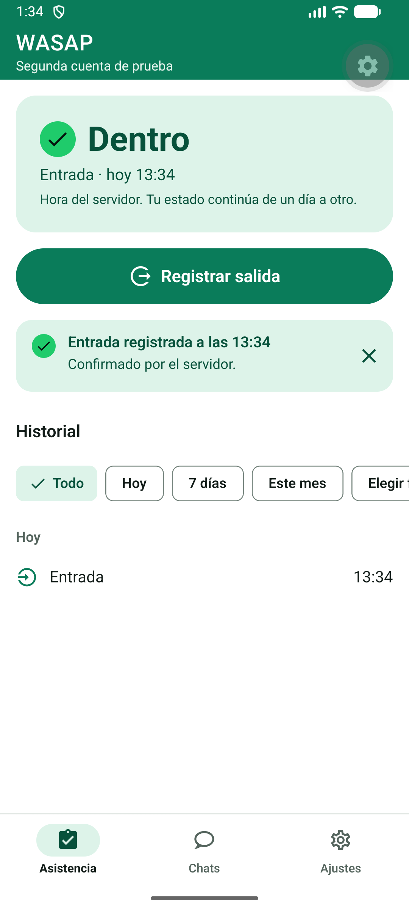
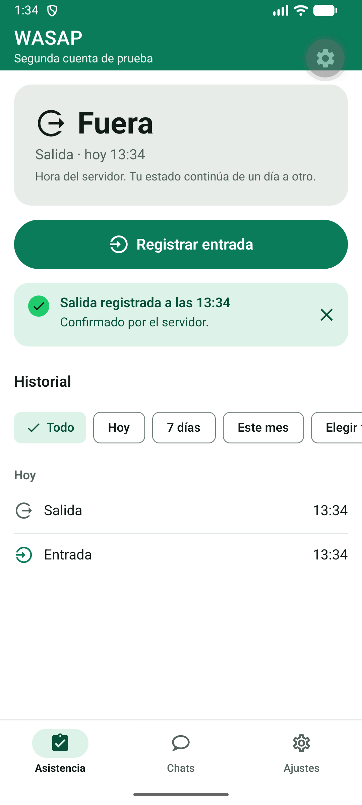
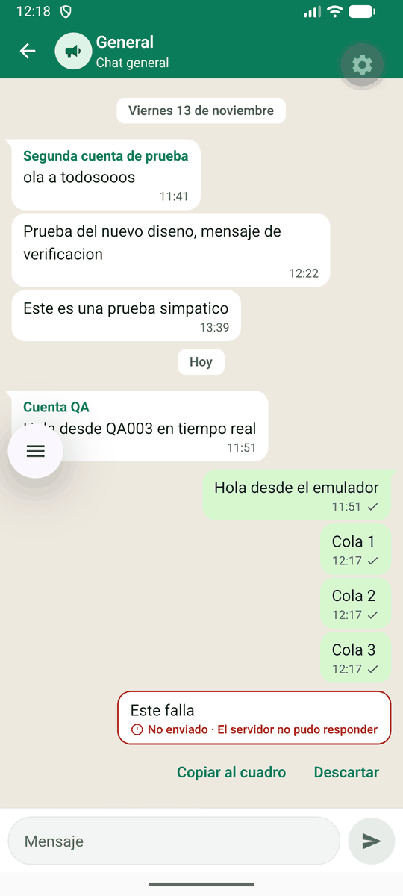

# Evidencia y estado de verificación

Fecha de esta actualización: **14 de noviembre de 2026**.

## Capturas reales de Android

Las imágenes corresponden al build instalado en `emulator-5554`, con código
cargado desde Metro y conexión al servidor local mediante `adb reverse`.
Muestran la cuenta DEMO002 y movimientos de prueba autorizados por el usuario.
No son mockups.

| Entrada confirmada: Dentro | Salida confirmada: Fuera |
| --- | --- |
|  |  |

El servidor devolvió exactamente dos movimientos para DEMO002:

| Movimiento | Instante UTC | America/Mexico_City |
| --- | --- | --- |
| ENTRY | 2026-11-14T19:34:06.997118Z | 13:34:06 |
| EXIT | 2026-11-14T19:34:30.595020Z | 13:34:30 |

Se comprobaron título de estado, siguiente acción, sello de confirmación e
historial. Una revisión visual independiente consideró Dentro/Fuera resueltos.
Los chips son legibles y la selección es visible; no se verificó la interacción
del selector de fechas en esa pasada. No existe un veredicto global de «ship».

## Cola de salida de mensajes (17 de noviembre de 2026)

Con el servidor local en pausa se escribieron cuatro mensajes seguidos en el chat
General desde `emulator-5554` (cuenta DEMO001). Para provocar un rechazo definitivo
se añadió temporalmente a la base local una restricción que rechaza el texto exacto
«Este falla» (el servidor responde `INTERNAL`); se eliminó al terminar.

| En cola, servidor en pausa | Tras reanudar: enviados en orden y uno no enviado |
| --- | --- |
|  |  |

- Los cuatro quedaron «Pendiente» en el orden escrito y el compositor siguió libre.
- Al reanudar, la base guardó una sola fila de «Cola 1», «Cola 2» y «Cola 3» con
  secuencias consecutivas (6, 7, 8); «Este falla» no se guardó y la cola siguió.
- Una segunda cuenta (QA003) conectada en paralelo recibió los tres en orden. El
  evento de «Cola 1» llegó dos veces porque la app reenvió el mismo UUID tras
  agotar su espera y el servidor repite el aviso de un reintento confirmado; es el
  mismo mensaje (mismo `id`) y los clientes lo deduplican.
- «Copiar al cuadro» devolvió el texto al compositor y quitó el aviso.

## Comprobaciones realizadas

| Área | Evidencia | Alcance |
| --- | --- | --- |
| Móvil | 49 pruebas y TypeScript aprobados (17 de noviembre de 2026) | Protocolo, recuperación, cola de salida, directorio, filtros, calendario y presentación |
| Servidor | 41 pruebas (unitarias y de integración) aprobadas (17 de noviembre de 2026) | PostgreSQL desechable, TLS, permisos, reintentos, sesiones persistentes, clientes lentos, paginación y fechas |
| Compose local | Imagen construida, servidor iniciado y healthcheck aprobado | Conexión TLS y base disponibles |
| Configuración Expo | `expo config --type public` válido | CA, plugins, permisos e identificadores |
| Impeccable Doctor | Sin findings para `mobile/src/App.tsx` | Configuración de la herramienta; no equivale a revisión visual |
| Android manual | Login, aviso de sesión vencida, Dentro/Fuera e historial | Un emulador y cuenta de prueba |

Las pruebas manuales anteriores reportadas por el usuario incluyen privados,
grupos y retirada de integrantes. No equivalen a probar dos dispositivos
conectados simultáneamente.

## Pendientes conservados

| Pendiente | Qué falta comprobar o construir |
| --- | --- |
| Operación pendiente | Capturar el reloj y recuperación tras cortar la conexión durante el envío |
| Integrantes | Revisar esa pantalla y sus acciones en dispositivo |
| Accesibilidad | Repetir los nuevos estados con fuente ampliada y navegación asistida |
| iPhone | Compilación en macOS y pruebas reales de navegación, TLS y red local |
| Tema oscuro | Habilitar integración nativa, recompilar y revisar ambos temas |
| Icono y arranque | Sustituir los recursos predeterminados y verificar el binario |
| Dos dispositivos | Comprobar entrega simultánea y recuperación |
| TLS negativo | CA incorrecta, expiración y SAN incorrecto en dispositivo |

No se han añadido confirmaciones de lectura, presencia, notificaciones push,
adjuntos ni nuevas mutaciones offline.

## Repetir las comprobaciones

Desde `mobile/`:

```bash
npm test
npm run typecheck
export WASAP_CA_PEM="$(cat ../certs/ca.crt)"
npx expo config --type public
```

Para las pruebas del servidor y PostgreSQL desechable, sigue
[el README principal](../README.md#desarrollo-y-pruebas). Para revisar el entorno
en ejecución utiliza [la guía local](local-runtime.md).

El informe histórico permanece en [mobile-report.md](mobile-report.md);
sus apartados antiguos describen el estado de aquella ejecución.
