# Evidencia y estado de verificación

Fecha de esta actualización: **14 de noviembre de 2026**.

## Capturas de la alpha (17 de noviembre de 2026)

APK de release firmado con la clave de alpha, instalado en `emulator-5554` y
conectado al servidor local con `adb reverse`. Cuenta DEMO001 y datos de prueba.

| Acceso                                                                          | Servidor                                                                         | Fuera                                                                                         | Dentro                                                                                                      | Chats                                                               |
| ------------------------------------------------------------------------------- | -------------------------------------------------------------------------------- | --------------------------------------------------------------------------------------------- | ----------------------------------------------------------------------------------------------------------- | ------------------------------------------------------------------- |
| 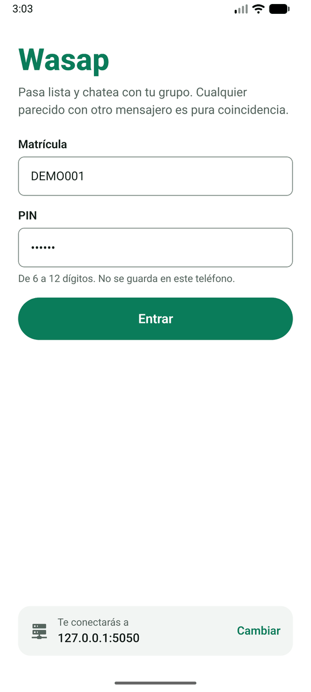 | 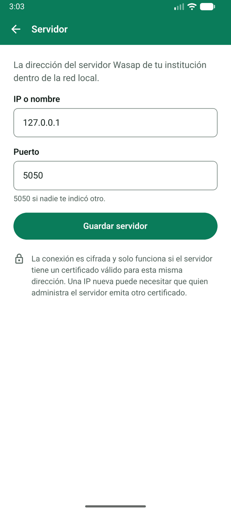 | 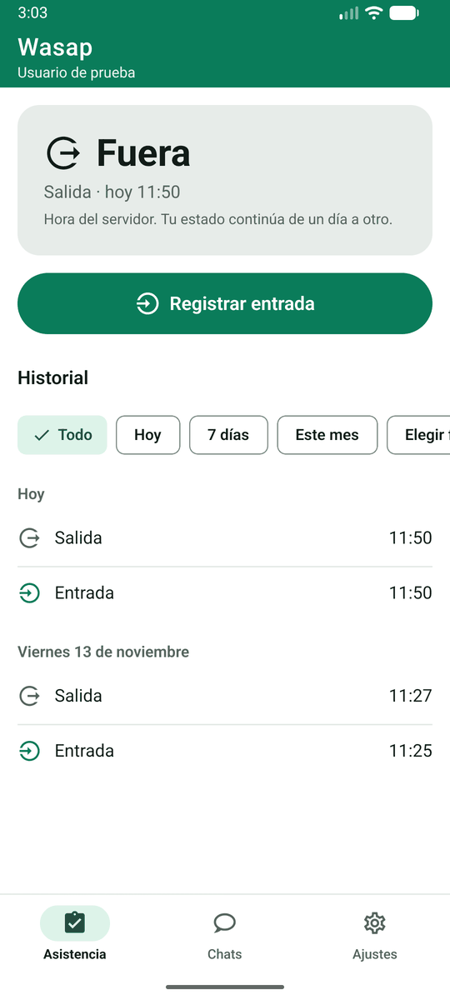 | 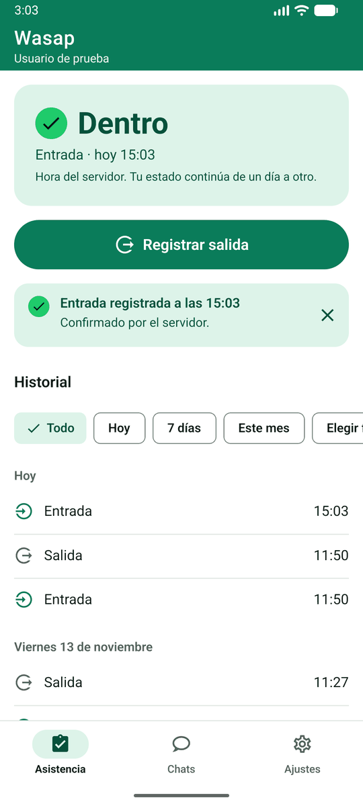 | 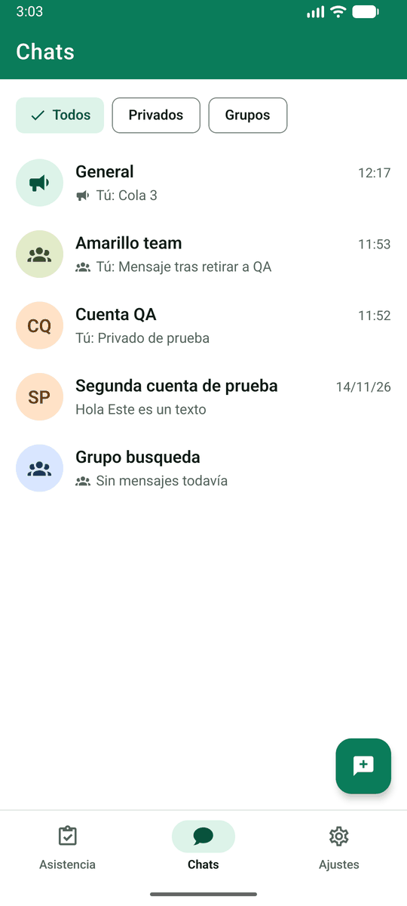 |

| Conversación                                                                                | Nuevo chat                                                                                               | Integrantes                                                                    | Ajustes                                                                                              | Diagnóstico                                                                    |
| ------------------------------------------------------------------------------------------- | -------------------------------------------------------------------------------------------------------- | ------------------------------------------------------------------------------ | ---------------------------------------------------------------------------------------------------- | ------------------------------------------------------------------------------ |
| 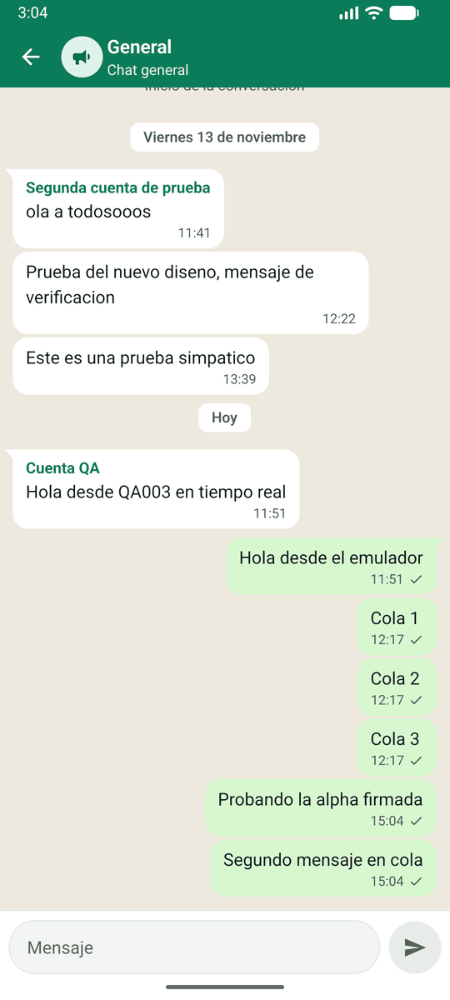 | 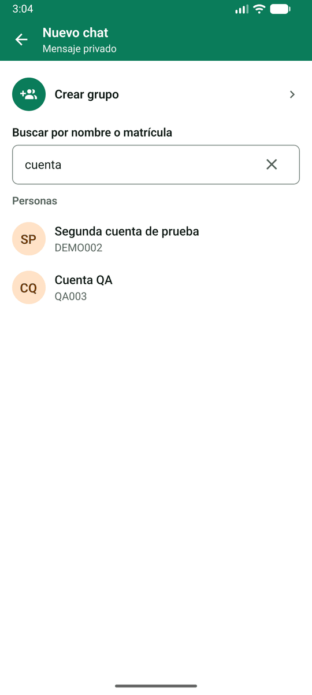 | 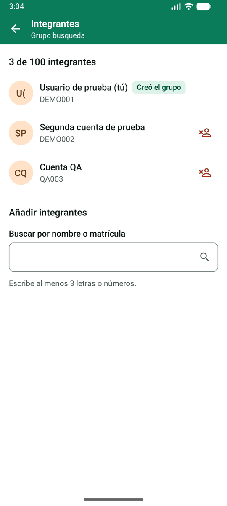 | 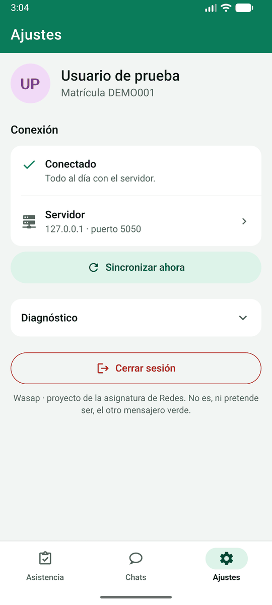 | 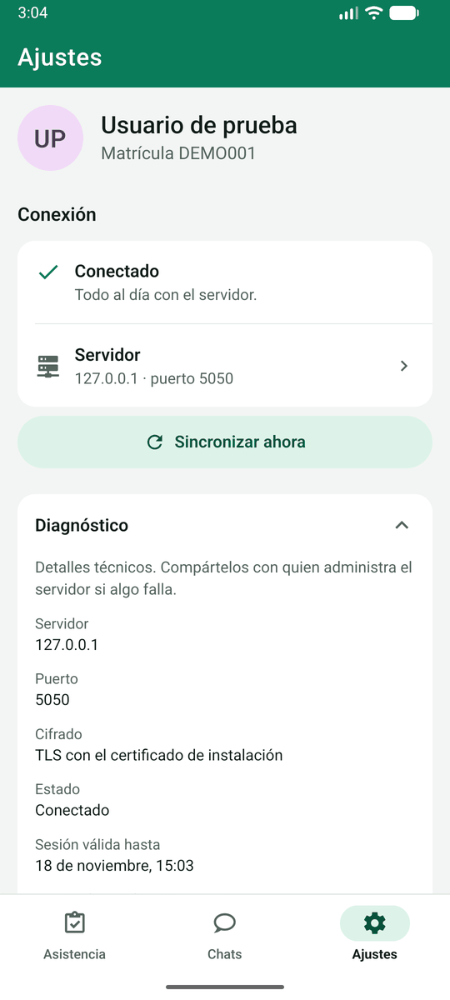 |

Verificado con este APK: inicio de sesión, entrada confirmada, lista de chats,
dos mensajes seguidos enviados en orden (secuencias 9 y 10) y reconexión sin pedir
PIN tras reiniciar el servidor. Detalle pendiente: las iniciales del avatar propio
en Integrantes salen como «U(» porque se calculan sobre «Usuario de prueba (tú)».

## Verificación anterior (14 de noviembre de 2026)

Con el build de desarrollo de entonces (cuenta DEMO002); sus capturas quedan en
[el informe móvil](mobile-report.md).

El servidor devolvió exactamente dos movimientos para DEMO002:

| Movimiento | Instante UTC                | America/Mexico_City |
| ---------- | --------------------------- | ------------------- |
| ENTRY      | 2026-11-14T19:34:06.997118Z | 13:34:06            |
| EXIT       | 2026-11-14T19:34:30.595020Z | 13:34:30            |

Se comprobaron título de estado, siguiente acción, sello de confirmación e
historial. Una revisión visual independiente consideró Dentro/Fuera resueltos.
Los chips son legibles y la selección es visible; no se verificó la interacción
del selector de fechas en esa pasada. No existe un veredicto global de «ship».

## Cola de salida de mensajes (17 de noviembre de 2026)

Con el servidor local en pausa se escribieron cuatro mensajes seguidos en el chat
General desde `emulator-5554` (cuenta DEMO001). Para provocar un rechazo definitivo
se añadió temporalmente a la base local una restricción que rechaza el texto exacto
«Este falla» (el servidor responde `INTERNAL`); se eliminó al terminar.

| En cola, servidor en pausa                                                                                                                | Tras reanudar: enviados en orden y uno no enviado                                                                                                                          |
| ----------------------------------------------------------------------------------------------------------------------------------------- | -------------------------------------------------------------------------------------------------------------------------------------------------------------------------- |
| 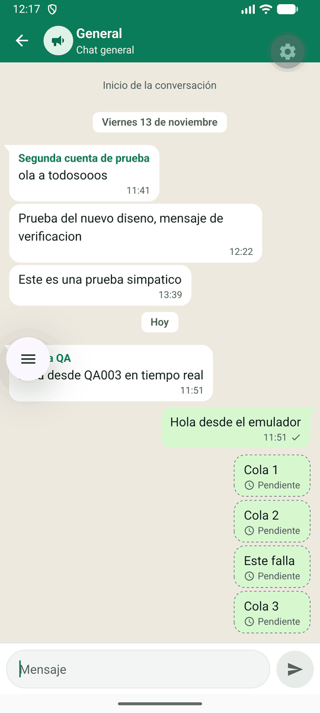 |  |

- Los cuatro quedaron «Pendiente» en el orden escrito y el compositor siguió libre.
- Al reanudar, la base guardó una sola fila de «Cola 1», «Cola 2» y «Cola 3» con
  secuencias consecutivas (6, 7, 8); «Este falla» no se guardó y la cola siguió.
- Una segunda cuenta (QA003) conectada en paralelo recibió los tres en orden. El
  evento de «Cola 1» llegó dos veces porque la app reenvió el mismo UUID tras
  agotar su espera y el servidor repite el aviso de un reintento confirmado; es el
  mismo mensaje (mismo `id`) y los clientes lo deduplican.
- «Copiar al cuadro» devolvió el texto al compositor y quitó el aviso.

## Asistencia por clase y roles (18 de noviembre de 2026)

Servidor local actualizado a la migración V5 sobre los datos existentes: las tres
cuentas previas quedaron como `student` y todos sus movimientos siguieron en la
puerta general. Con `admin users add` y `admin users role PROF01 teacher` se creó
una profesora. Desde `emulator-5554`, con el APK de release, ella creó las clases
«Redes 5A» (DEMO001 y QA003) y «Calculo 3B» (solo DEMO001).

| Crear clase (profesora)                                                                                                               | Estudiante dentro de una clase                                                                                                                      | Profesora en su clase                                                                                                                 | Lista de la clase                                                                                                    |
| ------------------------------------------------------------------------------------------------------------------------------------- | --------------------------------------------------------------------------------------------------------------------------------------------------- | ------------------------------------------------------------------------------------------------------------------------------------- | -------------------------------------------------------------------------------------------------------------------- |
| 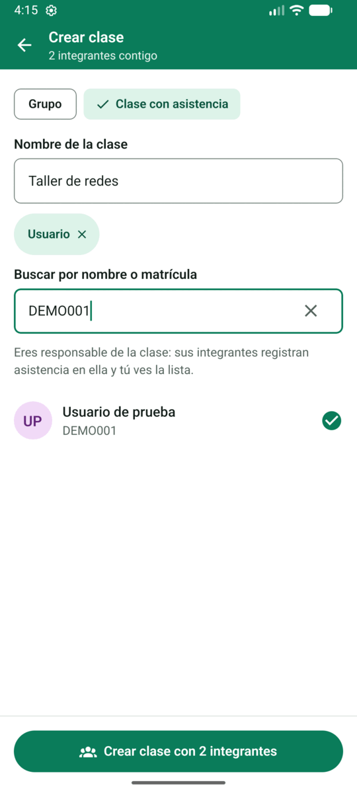 | 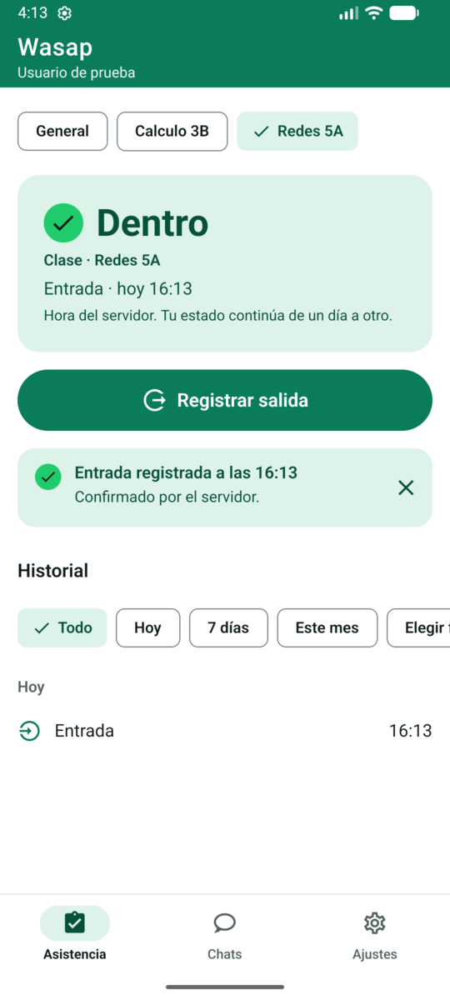 | 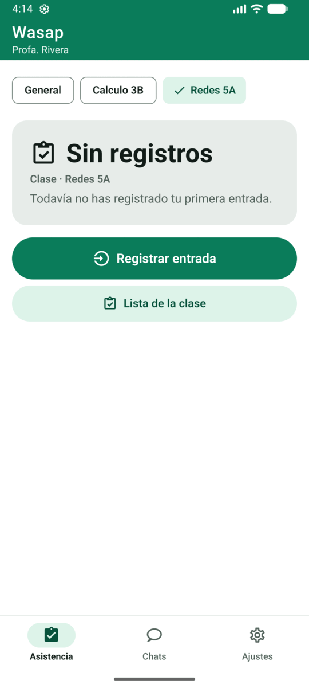 | 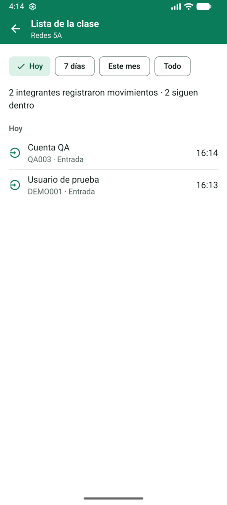 |

- Solo la cuenta `teacher` ve la opción «Clase con asistencia»; las clases aparecen
  como chips en Asistencia en cuanto se crean, sin reiniciar la app.
- DEMO001 registró entrada en «Redes 5A»: «Calculo 3B» siguió «Sin registros» y la
  puerta general siguió en «Dentro · ayer 15:03».
- QA003 registró una entrada en la puerta general y otra en «Redes 5A». La lista
  de la clase muestra solo las dos entradas de la clase y omite la de la puerta.
- `admin attendance '*' 2026-11-18 2026-11-18 --class <id> --csv` devolvió esas
  mismas dos filas con hora local; sin `--class` aparece también la fila «General».
- Antes de crear las clases, DEMO001 veía Asistencia igual que en la v1, sin chips.
  Con un servidor anterior, sin `classes.list`, la app hace lo mismo (prueba del motor).

## Varios servidores por QR (18 de noviembre de 2026)

Dos servidores locales con CA distintas: «Wasap» (Compose, puerto 5050, CA de
instalación) y «Profe Beta» (`wasap-server serve` en el puerto 5051, con su propia CA
creada por `certs init` y certificado de `certs issue`). Ambos enlaces salieron de
`wasap-server certs qr`. En `emulator-5554` se instaló el APK nuevo encima del anterior,
que tenía la sesión de PROF01.

| Lista de servidores                                                                                      | Confirmar con la huella                                                                                                         | Otro servidor en la misma dirección                                                                    | Escáner                                                                                                                | Iniciales                                                                                                                   |
| -------------------------------------------------------------------------------------------------------- | ------------------------------------------------------------------------------------------------------------------------------- | ------------------------------------------------------------------------------------------------------ | ---------------------------------------------------------------------------------------------------------------------- | --------------------------------------------------------------------------------------------------------------------------- |
| 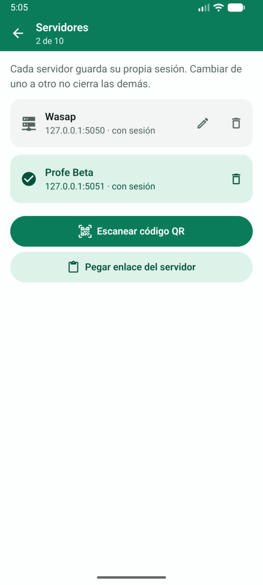 | 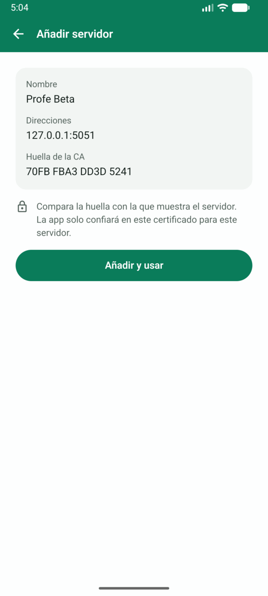 | 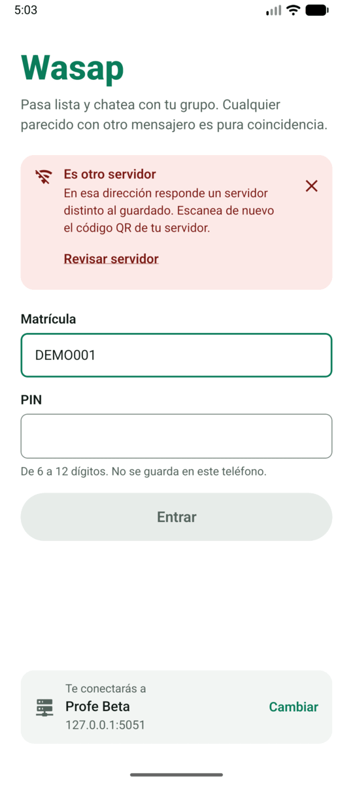 | 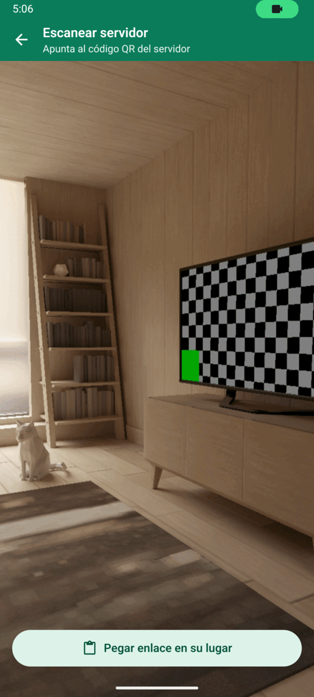 | 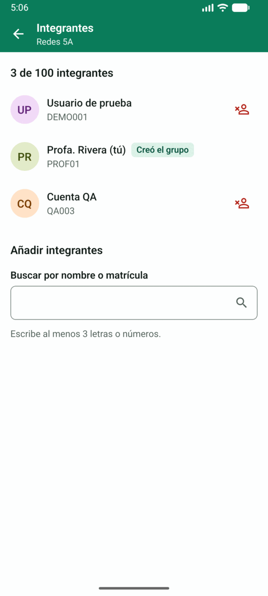 |

- **Migración:** al abrir el APK nuevo, la sesión de PROF01 siguió activa sin pedir PIN;
  el servidor de instalación tomó el identificador y el nombre de `server.hello`.
- **Alta:** «Profe Beta» se añadió pegando su enlace. La huella mostrada
  (`70FB FBA3 DD3D 5241`) coincide con la que imprime la consola.
- **Otro servidor en la misma dirección:** la base de pruebas vive en memoria y se
  borró al reiniciarse; «Profe Beta» arrancó con un identificador nuevo y la misma CA.
  La app mostró «Es otro servidor» y no envió credenciales. Tras eliminar el servidor
  viejo y añadir el QR nuevo, DEMO001 entró en Beta.
- **Cambio de servidor:** Wasap → Beta → Wasap desde Ajustes, sin volver a escribir el
  PIN; cada uno mostró solo sus chats y su asistencia.
- **Eliminar:** borrar el servidor activo volvió a «Wasap» con su sesión intacta.
- **Escáner:** la cámara se pide solo al tocar «Escanear»; la vista previa funciona. La
  lectura real de un QR no se probó en el emulador (su cámara muestra una escena
  virtual); el formato del QR sí se probó decodificando el PNG en las pruebas del
  servidor.
- **Iniciales:** «Profa. Rivera (tú)» muestra «PR».

## Comprobaciones realizadas

| Área               | Evidencia                                                                   | Alcance                                                                                                       |
| ------------------ | --------------------------------------------------------------------------- | ------------------------------------------------------------------------------------------------------------- |
| Móvil              | 49 pruebas y TypeScript aprobados (17 de noviembre de 2026)                 | Protocolo, recuperación, cola de salida, directorio, filtros, calendario y presentación                       |
| Servidor           | 41 pruebas (unitarias y de integración) aprobadas (17 de noviembre de 2026) | PostgreSQL desechable, TLS, permisos, reintentos, sesiones persistentes, clientes lentos, paginación y fechas |
| Compose local      | Imagen construida, servidor iniciado y healthcheck aprobado                 | Conexión TLS y base disponibles                                                                               |
| Configuración Expo | `expo config --type public` válido                                          | CA, plugins, permisos e identificadores                                                                       |
| Impeccable Doctor  | Sin findings para `mobile/src/App.tsx`                                      | Configuración de la herramienta; no equivale a revisión visual                                                |
| Android manual     | Login, aviso de sesión vencida, Dentro/Fuera e historial                    | Un emulador y cuenta de prueba                                                                                |

Las pruebas manuales anteriores reportadas por el usuario incluyen privados,
grupos y retirada de integrantes. No equivalen a probar dos dispositivos
conectados simultáneamente.

## Pendientes conservados

| Pendiente           | Qué falta comprobar o construir                                           |
| ------------------- | ------------------------------------------------------------------------- |
| Operación pendiente | Capturar el reloj y recuperación tras cortar la conexión durante el envío |
| Integrantes         | Revisar esa pantalla y sus acciones en dispositivo                        |
| Accesibilidad       | Repetir los nuevos estados con fuente ampliada y navegación asistida      |
| iPhone              | Compilación en macOS y pruebas reales de navegación, TLS y red local      |
| Tema oscuro         | Habilitar integración nativa, recompilar y revisar ambos temas            |
| Icono y arranque    | Sustituir los recursos predeterminados y verificar el binario             |
| Dos dispositivos    | Comprobar entrega simultánea y recuperación                               |
| TLS negativo        | CA incorrecta, expiración y SAN incorrecto en dispositivo                 |

No se han añadido confirmaciones de lectura, presencia, notificaciones push,
adjuntos ni nuevas mutaciones offline.

## Repetir las comprobaciones

Desde `mobile/`:

```bash
npm test
npm run typecheck
export WASAP_CA_PEM="$(cat ../certs/ca.crt)"
npx expo config --type public
```

Para las pruebas del servidor y PostgreSQL desechable, sigue
[el README principal](../README.md#desarrollo-y-pruebas). Para revisar el entorno
en ejecución utiliza [la guía local](local-runtime.md).

El informe histórico permanece en [mobile-report.md](mobile-report.md);
sus apartados antiguos describen el estado de aquella ejecución.
